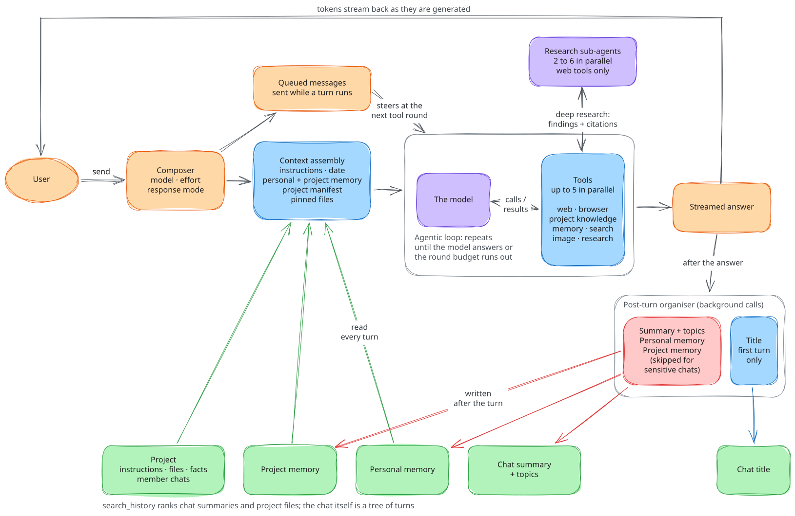
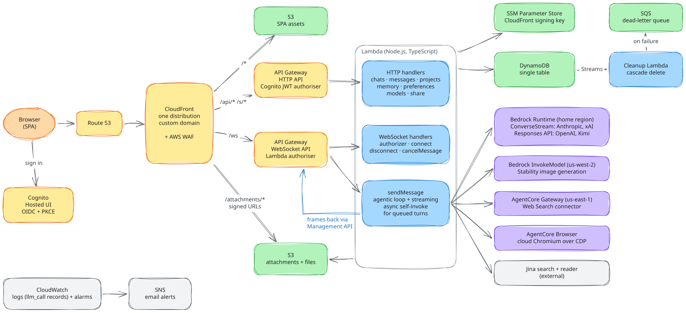

# Chatrock

**A private, multi-model AI chat workspace that runs entirely in your own AWS account.**

Chatrock is a ChatGPT / Claude.ai-style web app built on Amazon Bedrock. One interface
gives you Claude, GPT, Kimi and Grok models, plus web research with a real cloud browser,
long-term memory, projects with shared files and knowledge, branching conversations and
shareable links. It is fully serverless (Lambda, API Gateway, DynamoDB, S3, CloudFront),
deployed from a single Terraform stack. Nothing runs while nobody is chatting, and you pay
for Bedrock per token, not per seat.


## Who it's for

- **Teams and individuals who want a capable AI chat without handing their conversations
  to a third-party chat product.** Chat history, files and memory live in your DynamoDB
  table and S3 bucket. Inference goes to Bedrock in your account. The only other outbound
  calls are the web tools you choose to enable. Accounts are invite-only.
- **People who use several frontier models.** You can switch models mid-conversation, even
  between vendors, and the history carries over.
- **Engineers building something similar.** Chatrock is a deployed, working reference for:
  - token streaming from Lambda over API Gateway WebSockets
  - an agentic tool loop with parallel tools, budget pacing and sub-agents
  - one provider-neutral layer over both of Bedrock's chat APIs (Converse and Responses)
  - conversation trees in a single DynamoDB table
  - staying correct when the client is a phone that keeps going to sleep

  About 60 [architecture decision records](docs/adr/) explain the *why* behind each choice.

**What it isn't:** a hosted service, a framework or a multi-tenant SaaS with billing. It is
one deployment in one AWS account, with an opinionated deploy script.

## Highlights

### Conversations

- Answers stream in token by token, with the model's reasoning and every tool call shown
  live.
- The composer sets the model, thinking effort and response mode for each message.
- **Branching:** edit an earlier message or re-run an answer, and the new version becomes a
  branch. A `< 2 / 3 >` control flips between versions. **Fork** copies the current branch
  into a new chat.
- **Steer a running answer:** you can keep typing while the model works. A message sent
  during a long research turn is fed into it at the next tool boundary, so you can say
  "skip the 2019 papers" without stopping it. **Stop** keeps whatever was already written.
- Several chats can stream at the same time.
- Attach images, PDFs and text or code files. The browser downscales images before upload.
- New chats are titled automatically. You can also rename a chat or ask for a fresh AI
  title.
- **Export** a chat to Markdown, or **share** it as a read-only link with a QR code. A
  share is either a frozen snapshot or live, and can include the reasoning and tool calls.
  Shared pages are server-rendered HTML, or plain Markdown for `curl` and LLM agents.

### Research and tools

- **Three response modes:**
  - **Standard** allows up to 3 tool rounds.
  - **Research** allows up to 8.
  - **Deep research** has the model split the question into 2-6 sub-questions and hand
    each to a parallel researcher sub-agent. A wall-clock deadline bounds it, not a round
    count.
- **Go deeper** moves an answer up to the next mode and builds on the research already
  done.
- The model knows how much of its tool budget remains, so it wraps up its answer rather
  than being cut off mid-investigation.
- **Web search** uses Jina or Amazon Bedrock AgentCore Web Search. **Page fetch** uses
  Jina Reader.
- **A real cloud browser** (Amazon Bedrock AgentCore Browser) handles JavaScript-heavy
  pages. It can take screenshots and read rendered pages. Optionally, it can run scripted
  multi-step sessions that navigate, click and type.
- **Visual responses** draw charts, org charts, flow diagrams, and interactive
  explanations inline. Numeric charts use exact data; complex visuals use a configured
  specialist model. Choose Concise and visual or Standard in preferences.

### Memory and knowledge

- **Personal memory:** after each turn the assistant learns lasting facts about you
  (identity, preferences, writing style), and it remembers, updates or forgets when asked.
  You can see and edit everything it keeps.
- **Projects** group chats with shared instructions, files and project facts (decisions,
  conventions, constraints, glossary). Chats in a project see each other's summaries and
  can read each other on demand.
- **Search** instantly matches titles, summaries, topics and project files. Or choose "Ask
  AI to search by meaning" to have a model rank your history.

### Privacy

- **Private chats:** one click marks a chat *sensitive* and *auto-deleting*. A sensitive
  chat never feeds memory, summaries or search. An auto-deleting chat is removed after a
  set time. Private chats stay hidden in the sidebar until you reveal them. You can also
  set the two flags separately.
- The server enforces every rule. Each request reads the user's identity from the verified
  token, and a user can only ever reach their own data.

### Works on a phone

- The layout works down to 320 px wide, and navigation turns into a drawer on small
  screens.
- It is built for clients that sleep. The server always finishes a turn, even with nobody
  connected, and the app catches up by refetching when it comes back.

### Models

| Vendor | Models | Bedrock API |
|--------|--------|-------------|
| Anthropic | Claude Fable 5.1, Opus 5.5, Sonnet 5.5 (default), Haiku 5.5 | Converse |
| OpenAI | GPT-6 Astra, GPT-6.1 Sol, GPT-5.6 Terra, GPT-6 Luna | Responses |
| Moonshot AI | Kimi K3 | Responses |
| xAI | Grok 4.7 | Converse |

This is the lineup as of October 2026. Adding a model takes one entry in
[`backend/src/config/models.ts`](backend/src/config/models.ts). When a model is retired,
its chats continue on the model that replaces it.

---

## How it works: the logical view



### Chats are trees, not lists

Every turn has a parent, so a chat is a tree. Editing a message or re-running an answer
adds a sibling branch rather than overwriting anything. The chat remembers which branch
tip is active, and the UI shows the path from the root to that tip, with a version picker
wherever a turn has siblings. Forking copies the active path, attachments included, into a
new chat.

One assistant "bubble" can span several stored turns: reasoning, tool calls, tool results
and the final text of a single answer are grouped and shown as steps of that bubble. Turns
are stored as structured content blocks (text, reasoning, tool calls, tool results, images,
documents) in a provider-neutral format and replayed as stored. The app never rebuilds them
from display text.

### Anatomy of a turn

1. **Send.** The composer sends the message over a WebSocket, along with the chosen model,
   thinking effort and response mode. The server claims the chat's single turn slot. If a
   turn is already running, the message is queued.
2. **Assemble context.** The system prompt is rebuilt for every turn from these parts:
   - custom instructions
   - the current date
   - answer-length preference
   - personal memory
   - project instructions
   - project memory
   - a manifest of the project's files and chats
   - any files pinned into the prompt

   Settings are layered. Model defaults come first, then your preferences, the project,
   the chat, and finally the composer's choices for this message.
3. **Agentic loop.** The model streams a response. When it calls tools, up to five run in
   parallel and their results go back to the model. This repeats until the model answers or
   the mode's budget runs out. Each round is saved as soon as it completes, so a dropped
   connection never loses finished work. As the budget runs low, the model is told how
   many rounds remain.
4. **Steering.** Messages queued while the turn runs are written into the conversation
   after the next tool round, and the model continues with them in view.
5. **Answer.** The final text streams to the client, followed by token usage.
6. **Organise.** After the answer, background calls update the chat's title, summary and
   topics, personal memory and project memory. These are described below.

### Tools

| Tool | What it does | Default |
|------|--------------|---------|
| `web_search` | Search the web (Jina or AgentCore Web Search) | on |
| `web_fetch` | Fetch a page as clean text (Jina Reader) | on |
| `take_screenshot`, `get_rendered_page` | Open one URL in a real cloud browser | on |
| `browse_web` | Scripted multi-step browser session (navigate, click, type; up to 15 steps) | off |
| `create_visual` | SVG charts, diagrams and interactive HTML | on (specialist calls use tokens) |
| `manage_memory` | Remember, update or forget a personal fact | on, with memory |
| `manage_project_memory` | The same, for project facts | project chats |
| `read_project_file`, `read_project_chat` | Read a project file or sibling chat, as a summary or in full | project chats |
| `search_history` | Search your past chats and project files by meaning | on |
| `run_research_task` | Hand a sub-question to a researcher sub-agent | Deep research only |

Screenshots and generated images are stored in S3 and shown inline in the answer.

### Titles, summaries and memory

After every answer, a set of independent background calls organises the conversation:

- **Title.** After the first answer, a small fast model (Haiku) writes a title of six
  words or fewer from the opening exchange. The title is pushed live to the sidebar.
- **Summary and topics.** Every turn merges the latest exchange into a running summary
  and a topic list. Summaries feed the project manifest, cross-chat reads and search.
- **Personal memory.** Memory has two writers:
  - *Explicit:* the model calls `manage_memory` during the turn, for example after "remember
    I prefer metric units".
  - *Passive:* after the turn, a model pulls lasting facts from the exchange and reconciles
    them against current memory, adding, updating or deleting facts as needed. Current
    memory is re-read *after* the turn, so this never duplicates what the model just wrote.
    Facts you add or edit by hand are never overwritten.

  Each fact has a category (identity, preference, style, other) and is injected into every
  turn with its id, so the model can update or forget a specific fact. A small card in the
  chat shows what changed.
- **Project memory** works the same way within a project. Its categories are decision,
  convention, fact, constraint, glossary and other.

A **sensitive** chat still gets a title, which lives on the chat itself and is hidden in
the sidebar. Its content never reaches summaries, memory or search. Memory can also be
switched off per chat, and project memory per project.

### Projects

A project groups chats around shared instructions, files and facts. Membership is just a
label on the chat, so moving a chat in or out is instant. Project context reaches the
model in layers, so even a large project doesn't flood the prompt:

- **Manifest (always included):** one line per file (name and a short label) and per
  sibling chat (title and a snippet of its summary). It is capped at 50 files and 30
  chats.
- **Summary (on demand):** the model calls `read_project_file` or `read_project_chat`.
- **Full content (on demand):** the same tools return the complete text, image or
  transcript.

Each uploaded file is summarised into a short label and a summary, and PDFs also get their
text extracted. Every file has one of three settings: *relevant material* (listed and read
on demand), *included excerpt* (pinned into the prompt, within a size limit) or *excluded*.

### Search

- **Instant search** in the sidebar matches titles, summaries, topics and project files.
  It doesn't call a model.
- **AI search** ("Ask AI to search by meaning") starts a chat that has to call
  `search_history` first. A model ranks your chat summaries and project files against the
  question and explains each match. The same tool is available in any chat, so you can ask
  "what did we decide about X last month?" mid-conversation.

### Switching models mid-chat

History is stored in a provider-neutral format and converted to each vendor's wire format
for every call. Vendor-private material, such as signed reasoning blocks, is replayed only
to the provider and model that produced it, and dropped for the others. A chat can
therefore move from Claude to GPT to Kimi and back without errors or misattributed
reasoning.

---

## How it works: the technical view



### Request paths

A single CloudFront distribution serves everything under one domain:

| Path | Destination | Auth |
|------|-------------|------|
| `/*` | S3: the React single-page app | none |
| `/api/*` | API Gateway HTTP API → Lambda | Cognito JWT authoriser |
| `/ws` | API Gateway WebSocket API → Lambda | Lambda authoriser (token in query string, since browsers can't set headers on WebSockets) |
| `/s/*` | Public share renderer | none (the unguessable share id is the capability) |
| `/attachments/*` | S3 | CloudFront signed URLs |

AWS WAF sits in front with AWS managed rule sets and a rate limit. Sign-in uses the Cognito
Hosted UI (OIDC with PKCE). Self sign-up is off, so an administrator creates every user.

### Frontend

React 18 and TypeScript, built with Vite. State lives in Zustand. Markdown is rendered with
GFM and syntax highlighting. The built files are served from S3 behind CloudFront. Each
WebSocket frame carries a `chatId`, so several chats can stream over one connection. When
the app resumes, it recovers by refetching, never by re-attaching to a stream.

### Backend

The backend is a set of TypeScript Lambda functions on Node.js 24, each bundled
separately with esbuild:

- **HTTP handlers:** create, read, update and delete for chats, messages, projects,
  memory, preferences and models, plus fork, export and share.
- **WebSocket handlers:** the `$connect` authoriser, connect, disconnect, `sendMessage`
  and `cancelMessage`.
- **`sendMessage`** is the core of the app. It can run for up to 15 minutes for deep
  research. It claims the chat's turn slot, runs the agentic loop, pushes frames to the
  client and runs the post-turn background calls. If messages were queued during the turn,
  it invokes itself asynchronously to run them.
- **Stream consumer:** cascades chat deletion to messages and S3 objects (see Data below).

### Streaming protocol

The server pushes JSON frames such as these:

- `thinking_delta` and `delta`: reasoning text and answer text
- `tool_call_start`, `tool_call` and `tool_result`: a tool call starting, its full input,
  and its result
- `sub_agent_progress`: live narration of a research sub-agent's work
- `usage`: token counts
- `titleUpdated` and `memoryUpdated`: post-turn updates
- `queued` and `user_message_injected`: steering a running turn
- `heartbeat`, `done`, `cancelled` and `error`

A heartbeat goes out every 4 s while a tool runs or the model is thinking silently. If the
model stays silent for 90 s, the round is aborted and retried. Cancelling sets a flag in
DynamoDB, which the stream loop polls every 750 ms. The full frame table is in
[`CLAUDE.md`](CLAUDE.md#websocket-event-protocol).

### LLM layer

- **One neutral block format, two adapters.** One adapter uses Bedrock **ConverseStream**
  (Anthropic, xAI). The other uses Bedrock's OpenAI-compatible **Responses API** on
  `bedrock-runtime` (OpenAI, Kimi). The agentic loop never branches on the provider.
- **Cross-region inference profiles.** All chat models are called through `global.*`
  inference profiles from the deployment's home region.
- **Stateless calls.** The full history is sent with every call, and no conversation
  state is kept with the provider.
- **Prompt caching.** Cache markers sit after the tool list, the system prompt and the
  stable part of the history.
- **Resilience.** A round that fails before producing any output is retried. A stalled
  stream is aborted and retried.
- **Observability.** Every LLM call, interactive or background, writes one structured
  `llm_call` log line with its purpose, model, tokens, cache hits, duration and outcome.
  One CloudWatch Logs Insights query covers cost and failures.
- **Background models.** Haiku writes titles. The default chat model (Sonnet) handles
  summaries, memory extraction, file summaries and search ranking. Research sub-agents
  use the chat's own model.

### Tool backends

| Tool | Backend |
|------|---------|
| Web search and page fetch | Jina (`s.jina.ai`, `r.jina.ai`), or the Amazon Bedrock AgentCore Web Search connector behind an AgentCore Gateway (MCP over SigV4, us-east-1) |
| Browser | Amazon Bedrock AgentCore Browser, driven over CDP by an embedded Playwright MCP server, one session per call |
| Visual output | Deterministic numeric charts and a configurable Bedrock visual specialist; isolated SVG/HTML previews |

### Data

- **DynamoDB, one table.** It holds every entity type: chats, message turns, WebSocket
  connections, preferences, personal memory, projects, project memory, project files and
  share links. Each user's data sits under a partition keyed by their Cognito `sub`.
  Messages are partitioned per chat, and one query returns a chat's whole tree.
- **Cascade delete through DynamoDB Streams.** Deleting a chat removes only the chat item.
  The stream event triggers a cleanup Lambda that deletes the chat's messages and S3
  objects. The same path handles TTL expiry of auto-deleting chats. Failed events go to
  an SQS dead-letter queue.
- **S3** stores attachments, project files and their extracted text, plus tool-generated
  images. The browser uploads straight to S3 with presigned PUT URLs. Files are displayed
  through short-lived CloudFront signed URLs, whose signing key lives in SSM.

### Reliability

Clients are often phones that background mid-answer and wake up on another network.
[`docs/realtime-reliability.md`](docs/realtime-reliability.md) sets out the rules that
follow from that:

- The server finishes the work whether or not anyone is listening.
- Progress is saved incrementally.
- Catching up means refetching, not re-attaching.
- Every push has a pull equivalent.
- Liveness markers expire.
- Credentials are read at connect time.
- Retry loops end in something the user can act on.

### Operations and security

- Every handler takes the user from the verified JWT and never from the request body.
- CloudWatch alarms send email through SNS. They cover Lambda errors, throttling, stream
  errors, API 5xx responses, WebSocket execution errors and dead-letter queue depth.
- Terraform defines all infrastructure. The one exception is a single manual AgentCore
  Gateway target step, documented in `terraform/agentcore.tf`.

---

## Repository layout

```
backend/     TypeScript Lambdas: src/http, src/ws, src/lib (LLM layer, tools, memory,
             search, tree), src/streams; prompts/ holds the background-call prompts; Jest tests
frontend/    React single-page app (Vite, Zustand) with Vitest tests
e2e/         Playwright tests that run against the live deployment
terraform/   All AWS infrastructure
docs/adr/    Architecture decision records
deploy.sh    Build and deploy: backend → Terraform → frontend → CloudFront invalidation
```

## Running your own

**Prerequisites:**

- An AWS account with Bedrock access to the models you want, in your region.
- Optionally, AgentCore Web Search in us-east-1.
- A Route 53 hosted zone for your domain.
- Terraform, Node.js 24 with npm, and the AWS CLI. The AgentCore Gateway target step needs
  AWS CLI 2.35.7 or later.

**Steps:**

1. Run `npm install` at the repo root.
2. Create `.env` at the repo root with your local settings. `deploy.sh` and the Playwright
   config both load it, and it is gitignored:

   ```bash
   AWS_PROFILE=my-profile             # the AWS CLI profile to deploy with
   AWS_REGION=ap-southeast-2          # the deployment's home region
   E2E_BASE_URL=https://chat.example.com
   COGNITO_USERNAME=e2e-user          # a Cognito user for the e2e tests
   COGNITO_PASSWORD="..."
   ```

   Only `AWS_REGION` is required for a deploy. If you don't set `AWS_PROFILE`, the AWS CLI
   and Terraform use their usual credential chain.
3. Create `terraform/terraform.tfvars` with at least `domain_name` and `hosted_zone_name`.
   You can also set `jina_api_key`, `alarm_email` and `ephemeral_chat_ttl_seconds`.
4. Run `./deploy.sh`, which does a full build and deploy.
5. Create a user in the Cognito user pool, since self sign-up is off.

## Development

```bash
npm --prefix backend test           # Jest
npm --prefix backend run typecheck
npm --prefix frontend test          # Vitest
npm --prefix frontend run build     # tsc + Vite
npm run test:e2e                    # Playwright against the live deployment
```

[`CLAUDE.md`](CLAUDE.md), [`backend/CLAUDE.md`](backend/CLAUDE.md) and
[`frontend/CLAUDE.md`](frontend/CLAUDE.md) are the detailed engineering notes.

## Design decisions

Every non-trivial decision is recorded in [`docs/adr/`](docs/adr/). Good starting points:

- [0004: Conversation tree model](docs/adr/0004-conversation-tree-model.md)
- [0039: Deep research as a sub-agent tool](docs/adr/0039-deep-research-as-a-sub-agent-tool.md)
- [0059: Queued user messages steer a running turn](docs/adr/0059-queued-user-messages-steer-a-running-turn.md)
- [0040: Concurrent per-chat streaming](docs/adr/0040-concurrent-per-chat-streaming.md)
- [0037: Catching up on a dropped stream](docs/adr/0037-catching-up-on-a-dropped-stream.md)
- [0048: OpenAI models on Bedrock Runtime](docs/adr/0048-openai-models-on-bedrock-runtime.md)
- [0008: Sensitive and ephemeral are independent flags](docs/adr/0008-sensitive-and-ephemeral-are-independent-flags.md)

## Author

[Michael Ludvig](https://github.com/mludvig)

## License

MIT. See [`LICENSE`](LICENSE.txt).
